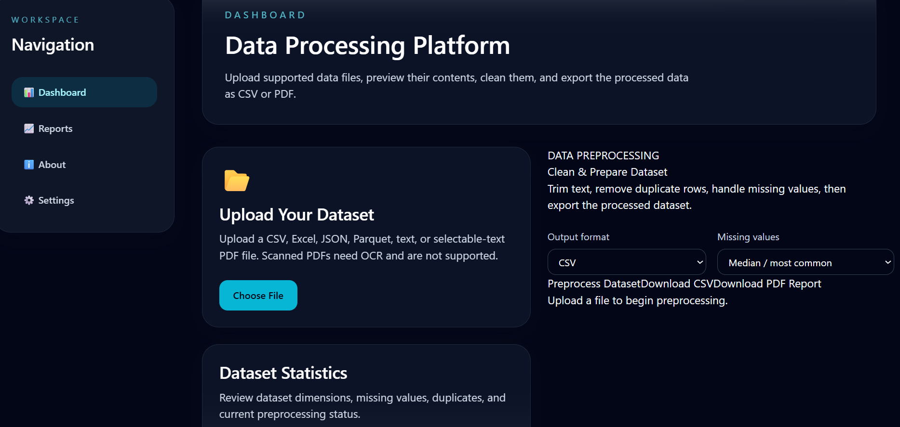

# Data Processing Platform

A web-based data processing application for uploading, exploring, cleaning, transforming, and exporting structured data.

## Overview

Data Processing Platform helps users prepare datasets through a simple web interface. It supports multiple file formats and provides preprocessing tools for improving data quality.

## Features

- **Multi-format uploads:** CSV, Excel (`.xlsx`, `.xls`), JSON, Parquet, text, and PDF.
- **Data inspection:** Preview uploaded datasets and inspect their structure.
- **Data cleaning:** Handle missing values, duplicate records, and outliers.
- **Data transformation:** Encoding, scaling, and feature selection.
- **Visualization:** Explore data through visual summaries.
- **Export:** Download processed datasets as CSV or PDF.

> PDF input supports selectable text and tables. Scanned/image-only PDFs are not currently supported.

## Technology Stack

**Backend**
- Python
- FastAPI
- Pandas and NumPy
- Scikit-learn
- Polars and Dask
- PyArrow
- pdfplumber and ReportLab

**Frontend**
- React
- Vite
- JavaScript
- Axios
- Chart.js and Plotly
- Tailwind CSS
- Three.js

## Screenshots

Add screenshots to `docs/screenshots/` and use these image paths:

| Screenshot | File |
|---|---|
| Main dashboard | `dashboard.png` |
| File upload and preview | `file-upload.png` |
| Preprocessing interface | `preprocessing.png` |
| Data visualization | `visualization.png` |



## Getting Started

### Prerequisites
- Python
- Node.js and npm

### 1. Clone the repository

```bash
git clone https://github.com/nasar-dataengineer/data-processing-platform.git
cd data-processing-platform
```

### 2. Install backend dependencies

```bash
python -m pip install -r backend/requirements.txt
```

### 3. Start the backend

```bash
python -m uvicorn backend.main:app --reload
```

Backend API: `http://127.0.0.1:8000`

### 4. Install frontend dependencies

Open another terminal in the project directory:

```bash
npm install
npm run dev
```

Open the local URL displayed by Vite, normally `http://localhost:5173`.

The frontend uses `http://127.0.0.1:8000` as its default API address. Set `VITE_API_BASE_URL` to override it.

## Tests

Run the backend file-format and preprocessing tests:

```bash
python -m unittest backend.tests.test_file_formats
```

## Project Structure

```text
data-processing-platform/
├── backend/
│   ├── modules/
│   ├── tests/
│   ├── utils/
│   ├── config.py
│   ├── main.py
│   ├── preprocessing.py
│   └── requirements.txt
├── public/
├── src/
│   ├── assets/
│   ├── components/
│   ├── pages/
│   ├── App.jsx
│   └── main.jsx
├── README.md
├── package.json
└── vite.config.js
```

## Project Status

The application has a working backend and frontend development setup, with backend tests and a production frontend build verified.

## Author

**Nasar Khan**

GitHub: [@nasar-dataengineer](https://github.com/nasar-dataengineer)

Repository: [Data Processing Platform](https://github.com/nasar-dataengineer/data-processing-platform)
